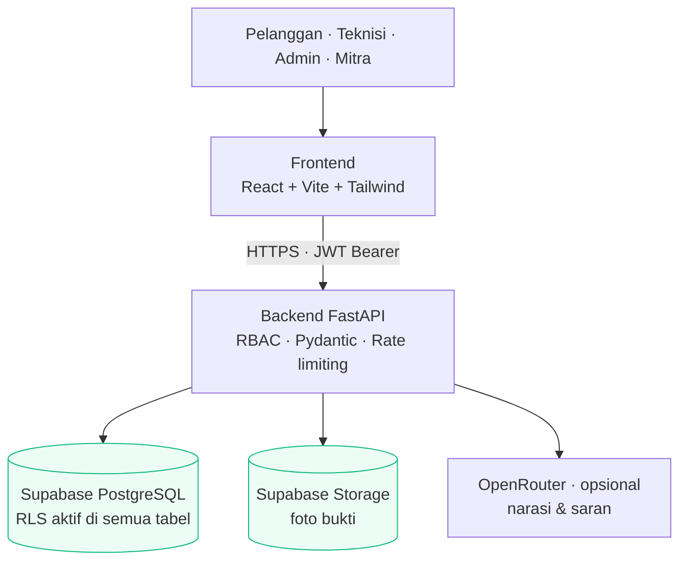

# Solea

**Sistem operasional laundry sepatu — full-stack, tanpa merek, siap disesuaikan.**

Solea menangani pemesanan pelanggan, progres teknisi, pelacakan status, foto bukti, hingga analisis omzet dan stok. Nama usaha, kontak, dan identitas visual diatur lewat environment variable, jadi tidak perlu menyunting kode untuk memakainya kembali.

> Sebelum dipakai produksi: isi `.env` dan `frontend/.env`, lalu jalankan SQL migrasi (lihat [Mulai Cepat](#mulai-cepat)).

---

## Daftar Isi

- [Ringkasan](#ringkasan)
- [Fitur](#fitur)
- [Arsitektur](#arsitektur)
- [Struktur Repository](#struktur-repository)
- [Mulai Cepat](#mulai-cepat)
- [Konfigurasi](#konfigurasi)
- [Script & Utilitas](#script--utilitas)
- [Pengujian](#pengujian)
- [Deployment](#deployment)
- [Backup](#backup)
- [Dokumentasi](#dokumentasi)

## Ringkasan

| Masalah | Solusi |
| :--- | :--- |
| Pencatatan manual rentan *human error* | Data terpusat dengan validasi di backend |
| Pelanggan tidak tahu progres cucian | Halaman cek status publik + notifikasi WhatsApp opsional |
| Admin kesulitan memantau omzet & komisi | Dashboard analitik deterministik dengan ringkasan AI opsional |

## Fitur

**Alur status:** `Diterima` → `Diproses` → `Diperiksa` → `Selesai` → `Siap Diambil`

| Peran | Fungsi Utama |
| :--- | :--- |
| **Pelanggan** | Katalog layanan, booking multi-pasang, cek status + foto bukti, riwayat transaksi |
| **Teknisi** | Daftar tugas, update progres, unggah foto (wajib sebelum "Selesai"), catat cacat barang |
| **Admin** | Dashboard omzet/stok/komisi, master harga, pengeluaran, manajemen pengguna, audit log |
| **Mitra** | Antrean cucian, input transaksi outlet, pemantauan performa cabang |

**Fitur pendukung:**

- **Notifikasi WhatsApp** — otomatis saat booking dibuat dan status berubah. Aktif kalau `WA_GATEWAY_URL` dan `WA_GATEWAY_TOKEN` diisi; jika tidak, diam-diam nonaktif.
- **Audit log** — jejak aksi sensitif (reset password, ubah user/harga, hapus data) melalui `GET /api/audit-log`.
- **Pembayaran** — titik integrasi gateway (QRIS/VA) lewat `POST /api/payments/intent` dan webhook. Tanpa `PAYMENT_API_URL`, endpoint mengembalikan 503, bukan QRIS palsu.
- **Analitik** — angka dihitung deterministik di backend; AI hanya membuat narasi, dengan fallback aturan lokal bila OpenRouter gagal.

## Arsitektur



Frontend **tidak mengakses database langsung**. Semua validasi dan otorisasi terpusat di backend yang memakai *service_role key*.

## Struktur Repository

```text
.
├── main.py                 # App FastAPI, config bersama, middleware, endpoint root
├── routers/                # Endpoint per domain (auth, transaksi, stats, audit, payments, ...)
├── analytics.py            # Analitik deterministik + ringkasan AI opsional
├── config.py               # BUSINESS_NAME, TRACKING_PREFIX, APP_ENV
├── notifications.py        # Adapter WhatsApp (best-effort)
├── payments.py             # Adapter gateway pembayaran
├── schema.sql              # Skema database baru
├── migrate.sql             # Migrasi database lama
├── rls.sql                 # Aktifkan RLS & kunci akses anon (wajib)
├── audit_log.sql           # Tabel audit
├── payments.sql            # Kolom pembayaran untuk database lama
├── seed_*.py               # Data master & dummy
├── bootstrap_admin.py      # Buat/atur password admin
├── setup_env.py            # Asisten membuat .env
├── check_*.py, test_api.py # Pemeriksa skema, audit auth, uji endpoint
├── scripts/                # Backup, wipe, atur akun, komisi
├── frontend/
│   ├── src/                # React (rute lazy-loaded)
│   ├── e2e/                # Tes Playwright
│   └── public/             # favicon & aset generik
├── docs/                   # PRD, arsitektur, panduan, serah terima
├── render.yaml, Procfile   # Deploy backend
└── .github/workflows/      # CI, cleanup foto, backup harian
```

## Mulai Cepat

### Prasyarat

- Python 3.12+, Node.js 20+ dengan npm, akun Supabase

### 1. Clone & backend

```bash
git clone https://github.com/<owner>/<repo>.git
cd <repo>

python -m venv .venv
.\.venv\Scripts\Activate.ps1     # Windows
source .venv/bin/activate        # macOS/Linux
pip install -r requirements.txt
```

### 2. Environment

```bash
cp .env.example .env             # Windows: copy .env.example .env
```

Isi nilai wajib: `SUPABASE_URL`, `SUPABASE_SERVICE_ROLE_KEY`, `JWT_SECRET_KEY`. Alternatif interaktif: `python setup_env.py`.

> Backend juga membaca `privat/.env` bila ada. Jangan commit `.env` maupun folder `privat/`.

### 3. Database

Jalankan di **Supabase SQL Editor** sesuai kondisi:

| Kondisi | File |
| :--- | :--- |
| Database baru | `schema.sql` |
| Database lama | `migrate.sql`, lalu `audit_log.sql`, `payments.sql` |
| Semua kondisi | **`rls.sql`** (wajib, sebelum aplikasi dibuka publik) |

Lalu isi data awal:

```bash
python seed_pricelist.py      # master layanan & harga
python bootstrap_admin.py     # admin baru — password acak, ganti setelah login
```

### 4. Frontend

```bash
cd frontend
npm ci
cp .env.example .env          # Windows: copy .env.example .env
npm run dev
```

Set `VITE_API_BASE_URL=http://127.0.0.1:8001`, lalu di terminal lain dari root:

```bash
uvicorn main:app --reload --port 8001
```

Buka **http://localhost:3000**.

## Konfigurasi

### Identitas aplikasi

| Lokasi | Variabel | Default | Dipakai untuk |
| :--- | :--- | :--- | :--- |
| `.env` | `BUSINESS_NAME` | `Solea` | Judul API, `/api/config`, pesan WhatsApp |
| `frontend/.env` | `VITE_BUSINESS_NAME` | `Solea` | Navbar, footer, judul halaman |

Keduanya harus bernilai sama. Ikon dan favicon bersifat generik.

### Variabel lain yang sering diubah

| Variabel | Fungsi |
| :--- | :--- |
| `BUSINESS_PHONE`, `BUSINESS_EMAIL`, `BUSINESS_ADDRESS` | Kontak di pesan & halaman status |
| `BUSINESS_HOURS`, `ACCEPTED_PAYMENTS`, `DROP_POINTS` | Jam buka, metode bayar, daftar drop point |
| `TRACKING_PREFIX` | Prefiks nomor tracking (default `TRX-`) |
| `APP_ENV`, `FRONTEND_ORIGINS` | `production` mewajibkan daftar origin; CORS tidak boleh `*` |
| `WA_GATEWAY_*` | Notifikasi WhatsApp opsional |
| `PAYMENT_API_URL`, `PAYMENT_API_KEY`, `PAYMENT_WEBHOOK_TOKEN` | Gateway pembayaran opsional |
| `OPENROUTER_API_KEY` | Ringkasan AI opsional |
| `CLEANUP_TOKEN` | Penghapusan foto otomatis via GitHub Actions |

> ⚠️ Nilai di `.env.example` masih contoh (`6280000000000`, `contact@example.com`). Ganti sebelum produksi.

## Script & Utilitas

Dijalankan dari root dengan virtual environment aktif.

| Perintah | Fungsi |
| :--- | :--- |
| `python setup_env.py` | Membuat/melengkapi `.env` |
| `python seed_pricelist.py` | Isi master layanan & harga |
| `python seed_dummy.py` / `--reset` | Isi / hapus data dummy |
| `python bootstrap_admin.py` | Buat admin atau reset password |
| `python check_schema.py` | Cek kolom database |
| `python check_auth.py` | Audit proteksi endpoint |
| `python test_api.py` | Uji endpoint & RBAC |
| `python scripts/backup_database.py` | Backup ke JSON lokal |
| `python scripts/hitung_ulang_komisi.py` | Hitung ulang komisi teknisi |

## Pengujian

```bash
cd frontend
npm run lint        # ESLint
npm run build       # Vite build
npm run check       # lint + build
npm run test:e2e    # Playwright, menyalakan Vite otomatis di :3000
```

Tes login E2E dilewati sampai `E2E_ADMIN_PHONE` dan `E2E_ADMIN_PASSWORD` diisi. Gunakan `E2E_BASE_URL` bila memakai server sendiri.

Backend: `check_schema.py`, `check_auth.py`, `test_api.py`. **Jangan jalankan seed terhadap database produksi.**

CI (`.github/workflows/ci.yml`) menjalankan lint + build frontend, `py_compile`, smoke test `import main` (menangkap router rusak), serta uji endpoint di Supabase staging bila secret `CI_SUPABASE_*` tersedia.

## Deployment

- **Backend:** `render.yaml` (Render) atau `Procfile` (Railway), keduanya menjalankan `uvicorn main:app --host 0.0.0.0 --port $PORT`.
- **Frontend:** `npm run build`, deploy `frontend/dist` ke hosting statis. Set `VITE_API_BASE_URL` dan `VITE_BUSINESS_NAME`.
- Set `APP_ENV=production` dan `FRONTEND_ORIGINS`. Tanpa keduanya backend sengaja gagal start daripada membuka CORS.
- Jalankan `rls.sql` sebelum aplikasi dibuka publik.

## Backup

`.github/workflows/backup.yml` berjalan harian pukul 18.00 UTC (01.00 WIB) dan bisa dijalankan manual dari tab Actions.

Secret GitHub yang wajib:

| Secret | Fungsi |
| :--- | :--- |
| `BACKUP_SUPABASE_URL` | URL project yang dibackup |
| `BACKUP_SUPABASE_SERVICE_ROLE_KEY` | Service-role key (bukan anon) |

Hasil diunggah sebagai artifact (retensi 30 hari). Untuk penyimpanan lebih lama, isi `BACKUP_S3_BUCKET`, `AWS_ACCESS_KEY_ID`, `AWS_SECRET_ACCESS_KEY`, `AWS_REGION`, dan opsional `BACKUP_S3_ENDPOINT` untuk R2/S3-compatible. File backup berisi data sensitif — jangan di-commit.

## Dokumentasi

- [`docs/prd.md`](docs/prd.md) — product requirements
- [`docs/blueprint.md`](docs/blueprint.md) — cetakan teknis
- [`docs/design.md`](docs/design.md) — UI/UX design system
- [`docs/ARSITEKTUR.md`](docs/ARSITEKTUR.md) — arsitektur & skema data
- [`docs/OPERASIONAL.md`](docs/OPERASIONAL.md) — alur kerja operasional
- [`docs/PANDUAN-PENGGUNA.md`](docs/PANDUAN-PENGGUNA.md) — panduan pemakai
- [`docs/data.md`](docs/data.md) — data yang perlu disiapkan
- [`docs/HANDOVER.md`](docs/HANDOVER.md) — serah terima
- [`docs/REPO-PRIVAT.md`](docs/REPO-PRIVAT.md) — pola kredensial terpisah
