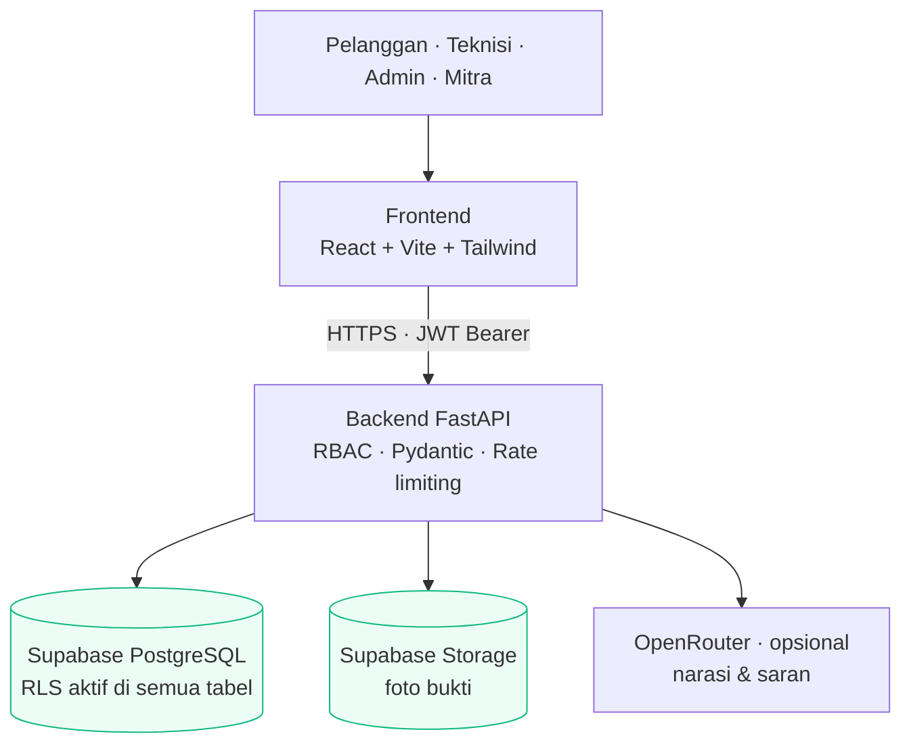

# Solea

> Sistem operasional laundry sepatu — full-stack, produksi-ready.

Solea mengubah cara kerja usaha cucian sepatu: dari catat manual yang rawan
*human error* menjadi sistem terpusat. Pelanggan booking & pantau status
sendiri, teknisi kerjakan sesuai antrean, admin pantau omzet & komisi real-time.

Dibangun production-grade: **Supabase + FastAPI + React**, dengan RLS di semua
tabel, audit log, backup otomatis, dan titik integrasi pembayaran.

[Fitur](#-fitur) · [Arsitektur](#-arsitektur) · [Mulai Cepat](#-mulai-cepat) ·
[Lisensi](#-lisensi) · [Dokumentasi](#-dokumentasi)

---

## Mengapa Solea

| Tantangan usaha cucian | Cara Solea menyelesaikannya |
| :--- | :--- |
| Catat manual, mudah salah & hilang | Data terpusat, tervalidasi di backend |
| Pelanggan bertanya-tanya "sudah mau jadi?" | Halaman tracking publik + notifikasi WhatsApp |
| Tidak jelas omzet & komisi teknisi | Dashboard analitik deterministik + audit log |
| Rawan kebocoran data | RLS aktif di semua tabel, frontend tak akses DB langsung |

**Siap produksi, bukan template setengah jadi.** Auth, RBAC, pembayaran,
backup, dan CI sudah tersedia dari awal. Anda tinggal ganti merek & kontak
lewat variabel environment — tanpa menyunting kode.

---

## ✨ Fitur

**Alur status:** `Diterima` → `Diproses` → `Diperiksa` → `Selesai` → `Siap Diambil`

| Peran | Yang bisa dilakukan |
| :--- | :--- |
| **Pelanggan** | Booking multi-pasang, cek status + foto bukti, riwayat |
| **Teknisi** | Antrean tugas, update progres, wajib foto sebelum "Selesai" |
| **Admin** | Dashboard omzet/stok/komisi, master harga, audit log |
| **Mitra (drop point)** | Input transaksi outlet, pantau performa cabang |

### Fitur produksi yang sudah termasuk

- 🔔 **Notifikasi WhatsApp** — otomatis saat booking & perubahan status (adapter gateway apa pun).
- 🧾 **Audit log** — jejak aksi sensitif (reset sandi, ubah harga, hapus data) via `GET /api/audit-log`.
- 💳 **Pembayaran** — titik integrasi gateway QRIS/VA. Tanpa provider, endpoint mengembalikan 503 yang jelas, bukan QRIS palsu.
- 📊 **Analitik deterministik** — angka dihitung di backend; AI hanya membuat narasi, dengan fallback bila provider gagal.
- 🔒 **Keamanan berlapis** — Argon2id, RBAC, rate limiting, CORS fail-closed di produksi, RLS Supabase.
- 🔄 **Backup otomatis** — workflow harian + offsite S3/R2 opsional.

---

## ⚙️ Arsitektur



Frontend **tidak pernah mengakses database langsung**. Semua validasi &
otorisasi terpusat di backend yang memakai *service-role key*. RLS diaktifkan
di semua tabel — jadi bocornya anon key pun tidak membuka data.

---

## 🚀 Mulai Cepat

<details>
<summary><b>Butuh setup cepat? Klik di sini</b> (4 langkah)</summary>

**Prasyarat:** Python 3.12+, Node.js 20+ & npm, akun Supabase.

1. **Backend** — clone, buat venv, `pip install -r requirements.txt`.
2. **Environment** — salin `.env.example` → `.env`, isi `SUPABASE_URL`,
   `SUPABASE_SERVICE_ROLE_KEY`, `JWT_SECRET_KEY` (atau `python setup_env.py`).
3. **Database** — jalankan SQL di Supabase: `schema.sql` (baru) atau
   `migrate.sql` + `audit_log.sql` + `payments.sql` (lama), lalu
   **`rls.sql` (wajib)**, kemudian `seed_pricelist.py` & `bootstrap_admin.py`.
4. **Frontend** — di `frontend/`: `npm ci`, salin `.env.example` → `.env`,
   `npm run dev`; jalankan backend di port 8001. Buka **http://localhost:3000**.

</details>

Instruksi lengkap, tabel migrasi, dan daftar variabel ada di
[Setup](#-detail-setup) dan [Dokumentasi](#-dokumentasi).

---

## 🔐 Lisensi

Solea dirilis dengan **lisensi MIT** — bebas dipakai, dimodifikasi, dan
disebarluaskan untuk evaluasi dan pembelajaran.

> Kredensial produksi disimpan di repo **privat terpisah**
> (pola di `docs/REPO-PRIVAT.md`) — tidak ada secret yang di-commit di sini.

---

## 📁 Struktur Repository

```text
.
├── main.py                 # App FastAPI, config bersama, middleware
├── routers/                # Endpoint per domain (auth, transaksi, stats, audit, payments)
├── analytics.py            # Analitik deterministik + ringkasan AI opsional
├── config.py               # BUSINESS_NAME, TRACKING_PREFIX, APP_ENV
├── notifications.py        # Adapter WhatsApp (best-effort)
├── payments.py             # Adapter gateway pembayaran
├── schema.sql / migrate.sql# Skema baru / migrasi lama
├── rls.sql                 # RLS + kunci akses anon (wajib)
├── audit_log.sql / payments.sql
├── seed_*.py / bootstrap_admin.py / setup_env.py
├── check_*.py, test_api.py # Pemeriksa skema & audit auth
├── scripts/                # Backup, komisi, utilitas
├── frontend/               # React (rute lazy-loaded) + tes Playwright
├── docs/                   # PRD, arsitektur, panduan, serah terima
└── .github/workflows/      # CI, cleanup foto, backup harian
```

---

## ⌨️ Detail Setup

### Prasyarat
- Python 3.12+, Node.js 20+ dengan npm, akun Supabase

### 1. Clone & backend
```bash
git clone https://github.com/mhmmd-naufl/Solea.git
cd Solea
python -m venv .venv
.\\.venv\\Scripts\\Activate.ps1     # Windows
source .venv/bin/activate        # macOS/Linux
pip install -r requirements.txt
```

### 2. Environment
```bash
cp .env.example .env             # Windows: copy .env.example .env
```
Isi nilai wajib: `SUPABASE_URL`, `SUPABASE_SERVICE_ROLE_KEY`, `JWT_SECRET_KEY`.
Alternatif interaktif: `python setup_env.py`.

> Backend juga membaca `privat/.env` bila ada. Jangan commit `.env` maupun folder `privat/`.

### 3. Database
Jalankan di **Supabase SQL Editor**:

| Kondisi | File |
| :--- | :--- |
| Database baru | `schema.sql` |
| Database lama | `migrate.sql`, lalu `audit_log.sql`, `payments.sql` |
| Semua kondisi | **`rls.sql`** (wajib, sebelum dibuka publik) |

Lalu:
```bash
python seed_pricelist.py      # master layanan & harga
python bootstrap_admin.py     # admin baru — sandi acak, ganti setelah login
```

### 4. Frontend
```bash
cd frontend
npm ci
cp .env.example .env
npm run dev
```
Set `VITE_API_BASE_URL=http://127.0.0.1:8001`, lalu di terminal lain dari root:
```bash
uvicorn main:app --reload --port 8001
```
Buka **http://localhost:3000**.

---

## ⚙️ Konfigurasi

### Identitas aplikasi
| Lokasi | Variabel | Default | Dipakai untuk |
| :--- | :--- | :--- | :--- |
| `.env` | `BUSINESS_NAME` | `Solea` | Judul API, `/api/config`, pesan WhatsApp |
| `frontend/.env` | `VITE_BUSINESS_NAME` | `Solea` | Navbar, footer, judul halaman |

Keduanya harus bernilai sama. Ikon & favicon generik, bisa diganti aset sendiri.

### Variabel lain yang sering diubah
| Variabel | Fungsi |
| :--- | :--- |
| `BUSINESS_PHONE`, `BUSINESS_EMAIL`, `BUSINESS_ADDRESS` | Kontak di pesan & halaman status |
| `BUSINESS_HOURS`, `ACCEPTED_PAYMENTS`, `DROP_POINTS` | Jam buka, metode bayar, daftar drop point |
| `TRACKING_PREFIX` | Prefiks nomor tracking (default `TRX-`) |
| `APP_ENV`, `FRONTEND_ORIGINS` | `production` mewajibkan daftar origin; CORS tak boleh `*` |
| `WA_GATEWAY_*` | Notifikasi WhatsApp opsional |
| `PAYMENT_API_URL`, `PAYMENT_API_KEY`, `PAYMENT_WEBHOOK_TOKEN` | Gateway pembayaran opsional |
| `OPENROUTER_API_KEY` | Ringkasan AI opsional |
| `CLEANUP_TOKEN` | Penghapusan foto otomatis via GitHub Actions |

> ⚠️ Nilai di `.env.example` masih contoh (`6280000000000`, `contact@example.com`). Ganti sebelum produksi.

---

## 🛠️ Script & Utilitas

| Perintah | Fungsi |
| :--- | :--- |
| `python setup_env.py` | Membuat/melengkapi `.env` |
| `python seed_pricelist.py` | Isi master layanan & harga |
| `python seed_dummy.py` / `--reset` | Isi / hapus data dummy |
| `python bootstrap_admin.py` | Buat admin / reset sandi |
| `python check_schema.py` | Cek kolom database |
| `python check_auth.py` | Audit proteksi endpoint |
| `python test_api.py` | Uji endpoint & RBAC |
| `python scripts/backup_database.py` | Backup ke JSON lokal |
| `python scripts/hitung_ulang_komisi.py` | Hitung ulang komisi teknisi |

---

## 🧪 Pengujian

```bash
cd frontend
npm run lint        # ESLint
npm run build       # Vite build
npm run check       # lint + build
npm run test:e2e    # Playwright, menyalakan Vite otomatis di :3000
```
Tes login E2E dilewati sampai `E2E_ADMIN_PHONE` & `E2E_ADMIN_PASSWORD` diisi.

Backend: `check_schema.py`, `check_auth.py`, `test_api.py`. **Jangan jalankan seed ke database produksi.**

CI (`.github/workflows/ci.yml`) menjalankan lint + build, `py_compile`, smoke test `import main`, serta uji endpoint bila secret `CI_SUPABASE_*` tersedia.

---

## 🚢 Deployment

- **Backend:** `render.yaml` (Render) atau `Procfile` (Railway), menjalankan `uvicorn main:app --host 0.0.0.0 --port $PORT`.
- **Frontend:** `npm run build`, deploy `frontend/dist` ke hosting statis; set `VITE_API_BASE_URL` & `VITE_BUSINESS_NAME`.
- Set `APP_ENV=production` + `FRONTEND_ORIGINS`. Tanpa keduanya, backend sengaja gagal start daripada membuka CORS.
- Jalankan `rls.sql` **sebelum** aplikasi dibuka publik.

---

## 💾 Backup

`.github/workflows/backup.yml` berjalan harian (18:00 UTC / 01:00 WIB) & bisa manual.

| Secret | Fungsi |
| :--- | :--- |
| `BACKUP_SUPABASE_URL` | URL project yang dibackup |
| `BACKUP_SUPABASE_SERVICE_ROLE_KEY` | Service-role key (bukan anon) |

Hasil jadi artifact (retensi 30 hari). Untuk retensi lebih lama, isi `BACKUP_S3_BUCKET`, `AWS_ACCESS_KEY_ID`, `AWS_SECRET_ACCESS_KEY`, `AWS_REGION` (+ `BACKUP_S3_ENDPOINT` untuk R2). File backup berisi data sensitif — jangan di-commit.

---

## 📚 Dokumentasi

- [`docs/prd.md`](docs/prd.md) — product requirements
- [`docs/blueprint.md`](docs/blueprint.md) — cetakan teknis
- [`docs/design.md`](docs/design.md) — UI/UX design system
- [`docs/ARSITEKTUR.md`](docs/ARSITEKTUR.md) — arsitektur & skema data
- [`docs/OPERASIONAL.md`](docs/OPERASIONAL.md) — alur kerja operasional
- [`docs/PANDUAN-PENGGUNA.md`](docs/PANDUAN-PENGGUNA.md) — panduan pemakai
- [`docs/data.md`](docs/data.md) — data yang perlu disiapkan
- [`docs/HANDOVER.md`](docs/HANDOVER.md) — serah terima
- [`docs/REPO-PRIVAT.md`](docs/REPO-PRIVAT.md) — pola kredensial terpisah

---

## 📄 Lisensi

MIT — lihat [`LICENSE`](LICENSE). Bebas dipakai dan dimodifikasi.
