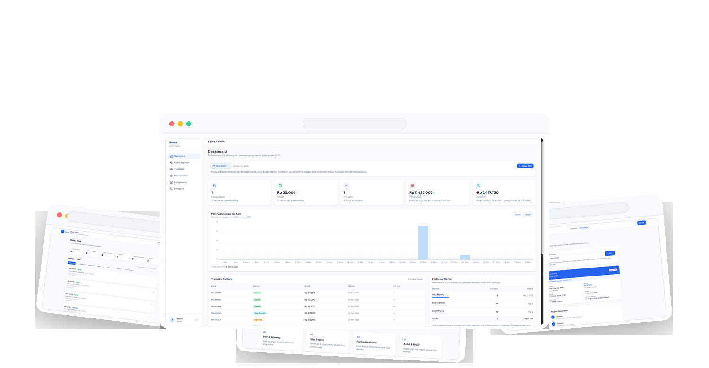
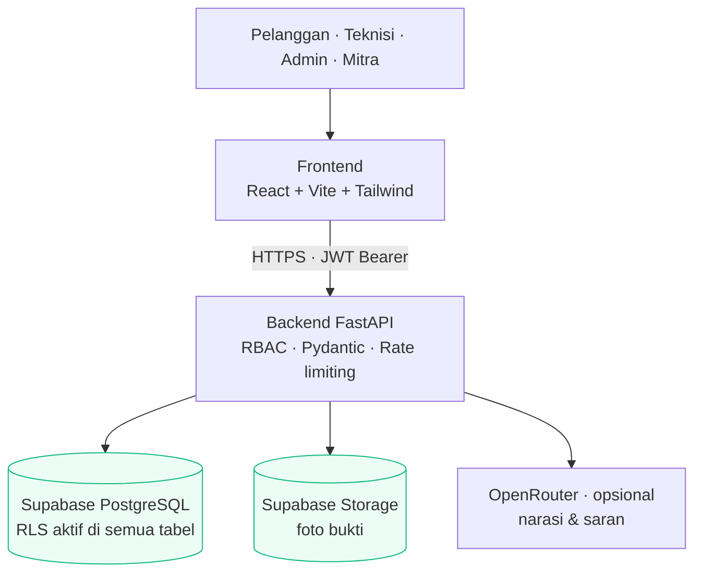

<p align="center">
  
</p>

<h1 align="center">Solea</h1>

<p align="center">
  <b>Sistem operasional laundry sepatu — full-stack, produksi-ready.</b>
</p>

<p align="center">
  <a href="https://solea-ten-pi.vercel.app"></a>
  
</p>

Solea mengubah cara kerja usaha cucian sepatu: dari catat manual yang rawan *human error* menjadi sistem terpusat. Pelanggan booking & pantau status sendiri, teknisi kerjakan sesuai antrean, admin pantau omzet & komisi real-time.

Dibangun production-grade dengan **Supabase + FastAPI + React**, RLS di semua tabel, audit log, backup otomatis, dan titik integrasi pembayaran.

## Preview

**Live demo:** [https://solea-ten-pi.vercel.app](https://solea-ten-pi.vercel.app) — login: `6280000000000` / `admin123`



## Features

**Alur status:** `Diterima` → `Diproses` → `Diperiksa` → `Selesai` → `Siap Diambil`

| Peran | Yang bisa dilakukan |
|:---|:---|
| **Pelanggan** | Booking multi-pasang, cek status + foto bukti, riwayat |
| **Teknisi** | Antrean tugas, update progres, wajib foto sebelum "Selesai" |
| **Admin** | Dashboard omzet/stok/komisi, master harga, audit log |
| **Mitra (drop point)** | Input transaksi outlet, pantau performa cabang |

### Production-ready

- **Notifikasi WhatsApp** — otomatis saat booking & perubahan status
- **Audit log** — jejak aksi sensitif (reset sandi, ubah harga, hapus data)
- **Pembayaran** — titik integrasi gateway QRIS/VA; tanpa provider, endpoint mengembalikan 503 yang jelas
- **Analitik deterministik** — angka dihitung di backend; AI hanya membuat narasi, dengan fallback
- **Keamanan berlapis** — Argon2id, RBAC, rate limiting, CORS fail-closed di produksi, RLS Supabase
- **Backup otomatis** — workflow harian + offsite S3/R2 opsional

## Arsitektur



Frontend **tidak pernah mengakses database langsung**. Semua validasi & otorisasi terpusat di backend yang memakai *service-role key*. RLS diaktifkan di semua tabel — bocornya anon key pun tidak membuka data.

## Quick Start

**Prasyarat:** Python 3.12+, Node.js 20+, akun Supabase.

```bash
# 1. Clone & setup
git clone https://github.com/mhmmd-naufl/Solea.git
cd Solea
python -m venv .venv && .venv\Scripts\activate
pip install -r requirements.txt

# 2. Environment
cp .env.example .env   # isi SUPABASE_URL, SUPABASE_SERVICE_ROLE_KEY, JWT_SECRET_KEY

# 3. Database
# Jalankan SETUP_SOLEA.sql di Supabase SQL Editor
python seed_direct.py  # seed layanan, admin, stock, drop point

# 4. Frontend
cd frontend
npm ci && cp .env.example .env && npm run dev
# Jalankan backend: uvicorn main:app --reload --port 8001
# Buka http://localhost:3000
```

<details>
<summary><b>Instruksi detail & tabel migrasi</b></summary>

### Environment

| Variabel | Wajib | Default | Fungsi |
|:---|:---:|:---|:---|
| `SUPABASE_URL` | ✅ | — | URL project Supabase |
| `SUPABASE_SERVICE_ROLE_KEY` | ✅ | — | Service-role key (bukan anon) |
| `JWT_SECRET_KEY` | ✅ | — | Kunci JWT — generate: `python -c "import secrets;print(secrets.token_urlsafe(64))"` |
| `APP_ENV` | ✅ | `development` | `production` mengaktifkan CORS fail-closed |
| `FRONTEND_ORIGINS` | ✅ (prod) | — | Daftar origin, dipisah koma |
| `BUSINESS_NAME` | | `Solea` | Nama yang tampil di UI & API |
| `BUSINESS_PHONE` | | | Nomor WA admin |
| `BUSINESS_HOURS` | | `09.00-20.00 WIB` | Jam operasional |
| `ACCEPTED_PAYMENTS` | | `tunai,transfer,qris` | Metode bayar, dipisah koma |
| `TRACKING_PREFIX` | | `TRX-` | Prefiks nomor tracking |
| `RATE_LIMIT_ENABLED` | | `true` | Matikan untuk testing |
| `CLEANUP_TOKEN` | | | Token verifikasi cron penghapusan foto |
| `OPENROUTER_API_KEY` | | | Ringkasan AI (opsional) |
| `PAYMENT_GATEWAY` | | `manual` | `manual` / `midtrans` / `xendit` |

> Backend juga membaca `privat/.env` bila ada. Jangan commit `.env` maupun folder `privat/`.

### Migrasi database

| Kondisi | File |
|:---|:---|
| Database baru | `SETUP_SOLEA.sql` |
| Database lama | `schema.sql` + `audit_log.sql` + `payments.sql` |
| Semua | RLS & GRANTs wajib aktif sebelum dibuka publik |

</details>

## Configuration

### Identitas

| Lokasi | Variabel | Default |
|:---|:---|:---|
| `.env` | `BUSINESS_NAME` | `Solea` |
| `frontend/.env` | `VITE_BUSINESS_NAME` | `Solea` |

Keduanya harus bernilai sama. Ikon aplikasi (juga dipakai sebagai logo di README) ada di [`frontend/public/assets/logo-solea-biru.svg`](frontend/public/assets/logo-solea-biru.svg) — ganti file ini (plus varian `-putih` dan `icon-*.png`) bila ingin memakai logo merek sendiri.

## Scripts

| Perintah | Fungsi |
|:---|:---|
| `python seed_direct.py` | Seed layanan, admin, stock, drop point |
| `python scripts/backup_database.py` | Backup ke JSON lokal |
| `python scripts/hitung_ulang_komisi.py` | Hitung ulang komisi teknisi |

## Testing

Frontend:
```bash
cd frontend
npm run lint        # ESLint
npm run build       # Vite build
npm run check       # lint + build
```

Backend: `python test_api.py` (jika ada) atau manual.

## Deployment

| Komponen | Platform | Konfigurasi |
|:---|:---|:---|
| Backend | Fly.io | `fly.toml` + `Dockerfile` (Python 3.12-slim, 512MB) |
| Frontend | Vercel | `vercel.json` (rewrite `/api/*` → Fly.io) |
| Database | Supabase | `SETUP_SOLEA.sql` |

Deploy otomatis: `.github/workflows/fly-deploy.yml` trigger push ke `main`.

## Backup

`.github/workflows/backup.yml` berjalan harian. Hasil jadi artifact (retensi 30 hari). Untuk retensi lebih lama, isi `BACKUP_S3_BUCKET` + AWS credentials di GitHub secrets.

## Struktur Repository

```text
.
├── main.py                 # FastAPI app, middleware, CORS, rate limiting
├── routers/                # Endpoint per domain (auth, transaksi, stats, audit, payments)
├── analytics.py            # Analitik deterministik + ringkasan AI opsional
├── config.py               # BUSINESS_NAME, TRACKING_PREFIX, APP_ENV
├── notifications.py        # Adapter WhatsApp
├── payments.py             # Adapter gateway pembayaran
├── SETUP_SOLEA.sql         # Skema + RLS + GRANTs (idempotent)
├── seed_direct.py          # Seed layanan, admin, stock, drop point
├── check_*.py / test_api.py
├── scripts/                # Backup, komisi, seed demo
├── frontend/               # React + Vite + Tailwind
│   ├── public/favicon.ico  # Favicon ICO multi-size
│   ├── public/assets/      # logo-solea-*.svg/png, icon-*.png (favicon & apple-touch-icon)
│   ├── public/screenshoots/ # Screenshot untuk README
│   ├── vercel.json         # Rewrite /api → Fly.io
│   └── src/
├── docs/                   # PRD, arsitektur, panduan
└── .github/workflows/      # CI, deploy, backup, cleanup
```

## Dokumentasi

- [`docs/prd.md`](docs/prd.md) — product requirements
- [`docs/blueprint.md`](docs/blueprint.md) — cetakan teknis
- [`docs/design.md`](docs/design.md) — UI/UX design system
- [`docs/ARSITEKTUR.md`](docs/ARSITEKTUR.md) — arsitektur & skema data
- [`docs/OPERASIONAL.md`](docs/OPERASIONAL.md) — alur kerja operasional
- [`docs/PANDUAN-PENGGUNA.md`](docs/PANDUAN-PENGGUNA.md) — panduan pemakai
- [`docs/data.md`](docs/data.md) — data yang perlu disiapkan
- [`docs/HANDOVER.md`](docs/HANDOVER.md) — serah terima
- [`docs/REPO-PRIVAT.md`](docs/REPO-PRIVAT.md) — pola kredensial terpisah

## License

MIT — lihat [`LICENSE`](LICENSE). Bebas dipakai dan dimodifikasi.
